# Error Detection Code Block: Synthesis → Place & Route

[← 메인으로](../)

Error Detection Code Block(top module: `TOP`)을 **Design Compiler로 합성**한 뒤, 그 netlist를 **IC Compiler II로 Floorplan부터 Sign-off check까지** 진행한 프로젝트입니다.

| 항목 | 내용 |
|---|---|
| 기간 | 2026.04 ~ (진행 중, KDT AI 시스템 반도체 설계 과정) |
| 설계 | 4-bit max / min / error(\|max − min\|) 3-stage pipeline |
| 라이브러리 | SAED32 32nm (HVT / RVT / LVT), 비교용 180nm |
| 범위 | Front-end → Back-end (P&R) |
| Tool | Design Compiler, Formality, VCS, IC Compiler II |
| 역할 | 합성 제약 작성, 위반 분석 및 수정, ICC2 전체 flow TCL 작성 및 실행 |
| 상세 자료 | [P&R (ICC2) PDF](docs/ErrorDetection_PnR_ICC2.pdf) · [합성 (DC) PDF](docs/ErrorDetection_Synthesis_DC.pdf) |

 

## 결과 요약

| 항목 | tt0p78v125c (slow) | tt1p05vn40c (fast) |
|---|---|---|
| Setup WNS / NVE | −0.00031 ns / 1 (PrimeTime ECO 예정) | +0.20554 ns / 0 |
| Hold WNS / NVE | +0.00686 ns / 0 | +0.00802 ns / 0 |
| Clock latency / skew | 0.62 / 0.03 | 0.34 / 0.02 |
| DRC / Open net | 0 / 0 | |
| LVS short / open / floating | 0 / 0 / 0 | |
| PG floating (VDD · VSS) | 0 | |
| Logic LVT 비율 | 1.46 % (spec < 20 %) | |
| Utilization | 0.3297 | |

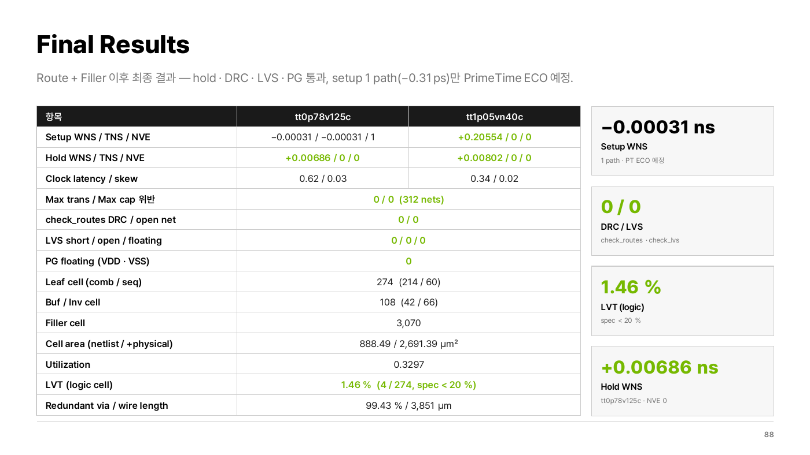

 

## Part 1. Front-end (Design Compiler · Formality · VCS)

### RTL 시뮬레이션

확인할 조건을 먼저 정리하고, 각 vector의 결과를 미리 예측한 뒤 시뮬레이션과 비교했습니다.

| 구간 | imax1–4 | imin1–4 | max / min / error | 확인 내용 |
|---|---|---|---|---|
| reset | 0,0,0,0 | 0,0,0,0 | 0 / 0 / 0 | 비동기 reset 초기화 |
| Case 1 | 8,7,6,5 | 1,2,3,4 | 8 / 1 / 7 | 극값이 1번 입력 · max > min |
| reset (동작 중) | 8,7,6,5 | 1,2,3,4 | 0 / 0 / 0 | 동작 중 비동기 reset |
| Case 2 | 3,4,2,1 | 6,5,7,8 | 4 / 5 / 1 | 극값이 2번 입력 · max < min |
| Case 3 | 3,2,4,1 | 5,6,4,7 | 4 / 4 / 0 | 극값이 3번 입력 · max = min |
| Case 4 | 7,6,5,8 | 2,3,4,1 | 8 / 1 / 7 | 극값이 4번 입력 · max > min |

모든 vector에서 예측값과 시뮬레이션 결과가 일치했고, 이 결과를 합성 후 검증의 기준으로 사용했습니다.

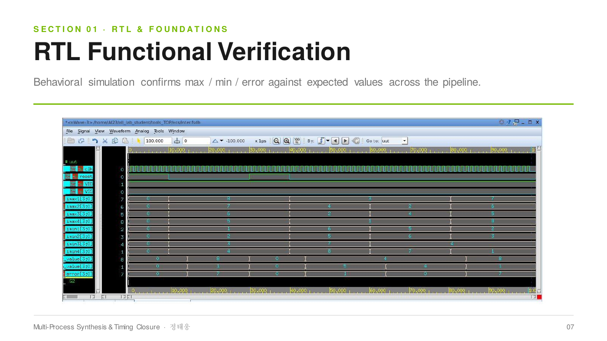

### 문제 1 — Max Capacitance 위반 66개
- **원인 분석**: `size_cell`은 timing만 개선하고 capacitance는 미감소
- **해결**: 최소한의 `insert_buffer` → `-only_design_rule` incremental compile로 timing은 고정한 채 DRC cost만 감소
- **결과**: 위반 66 → 8, buffer/inverter 469 → 285, cell area 1,565.8 → 1,209.2 µm²
- **잔여 8개**: spec에서 정한 출력 부하(≈ 3.0)가 max_cap 2.0보다 커서 구조적으로 만족 불가함을 확인

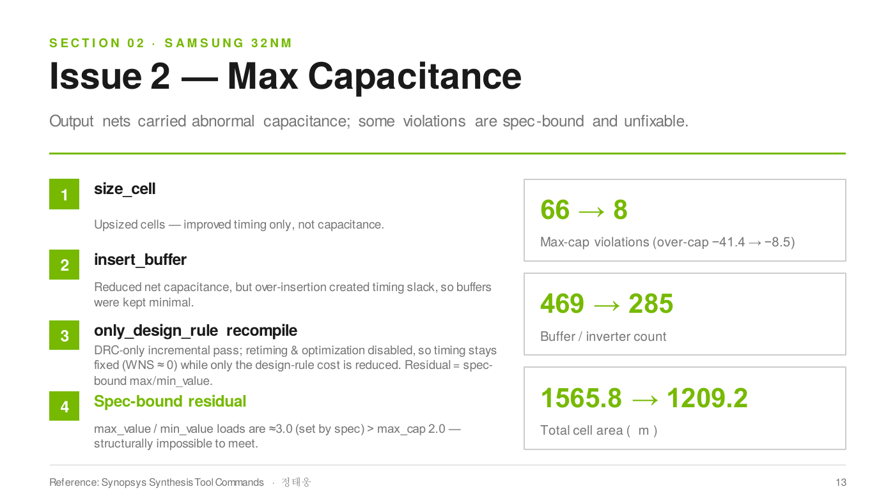

### 문제 2 — 0.78 V 설계에 0.85 V 셀이 link되는 문제
- **원인 분석**: DC의 mapping 엔진(셀 선택)과 timing 엔진(`set_operating_conditions`)이 서로 다른 라이브러리를 참조
- **해결**: `target_library`가 왼쪽부터 우선 적용된다는 점을 이용해 worst-case 라이브러리를 맨 앞에 배치

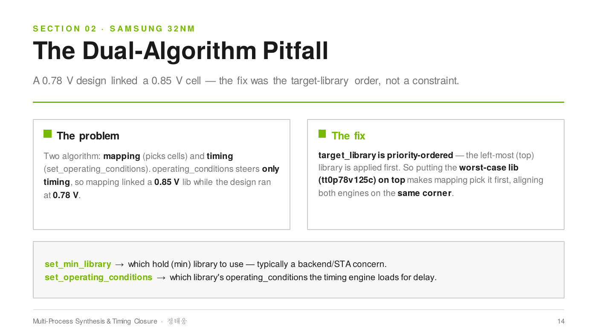

### 공정 비교 & Formality
같은 RTL을 32nm와 180nm에서 합성해 공정별 차이(area 1,209 vs 24,930 µm², power 0.51 vs 76.5 mW)를 비교했고, 두 공정 모두 Formality PASS를 확인했습니다.

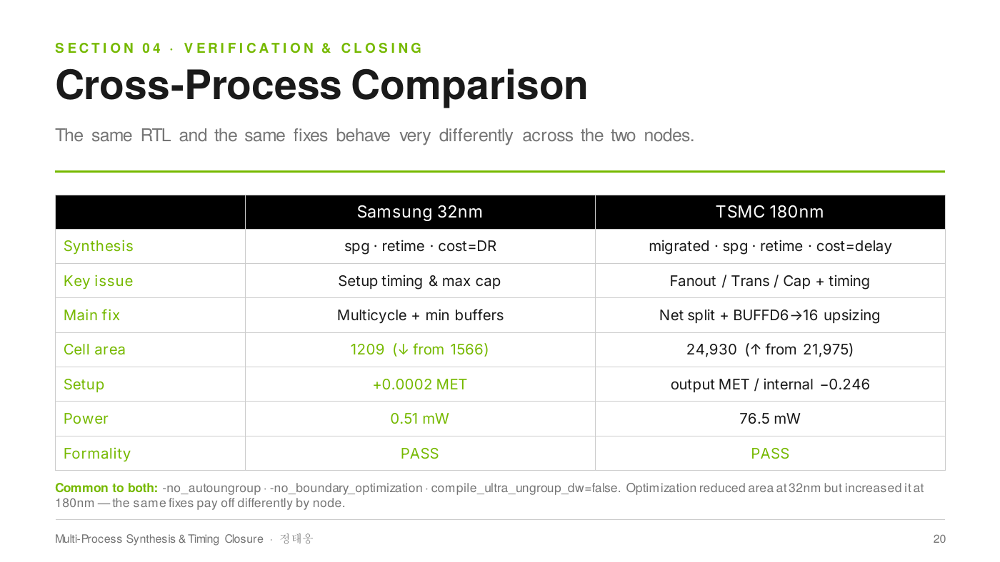

### Gate-level 시뮬레이션
- 합성 netlist가 RTL 시뮬레이션과 같은 결과를 재현 (worst-case library 기준 setup +0.0002 ns)
- X로 보이는 구간은 cell delay에 의한 전이 구간으로, 기능 불일치가 아님을 확인

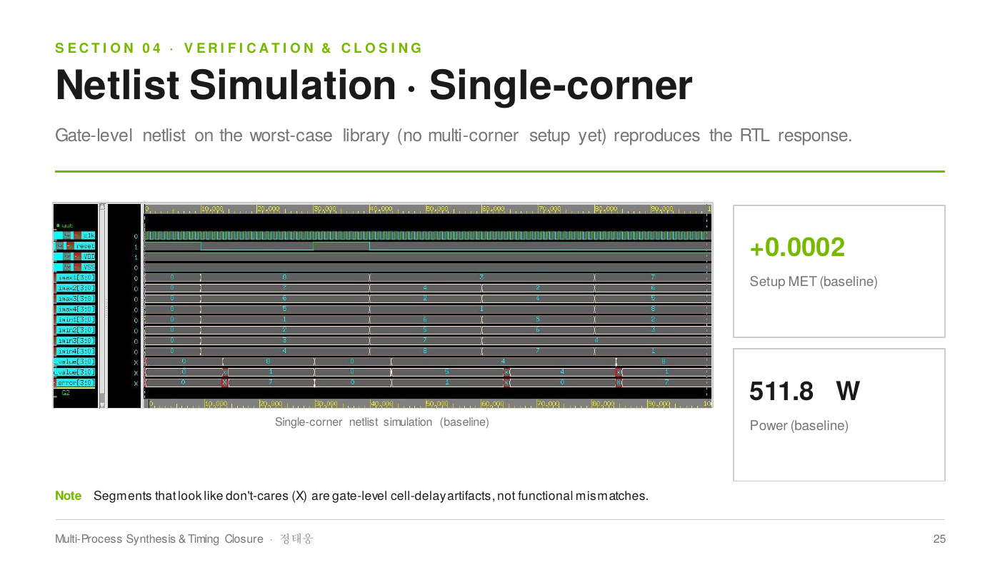

 

## Part 2. Back-end (IC Compiler II)

### Flow
Setup(NDM, MCMM 1 mode × 2 corner) → Floorplan & PNS → Place → CTS → Route → Filler & Sign-off check

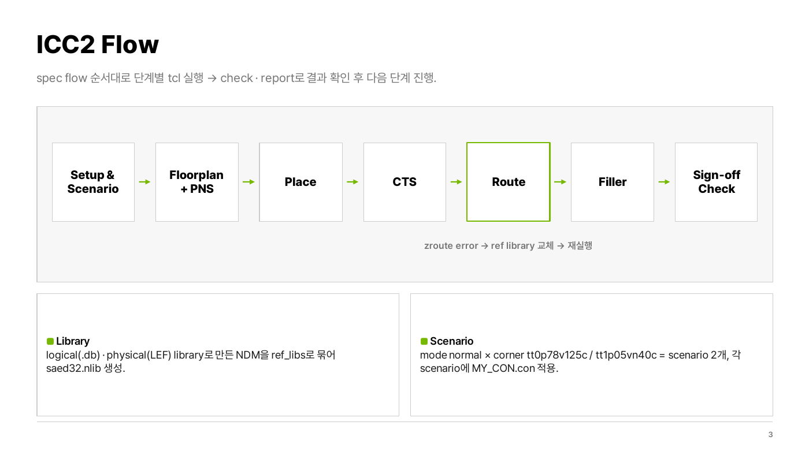

### Power Plan
- M3(H) / M4(V) core ring (width 1, spacing 0.3)
- M3 · M4 mesh (width 0.4, pitch 13.376), M1 std cell rail
- rail × M4 strap 교차점에 VIA12 / 23 / 34 stacked via
- `check_pg_connectivity` · `check_pg_drc` · `check_pg_missing_vias` 모두 통과

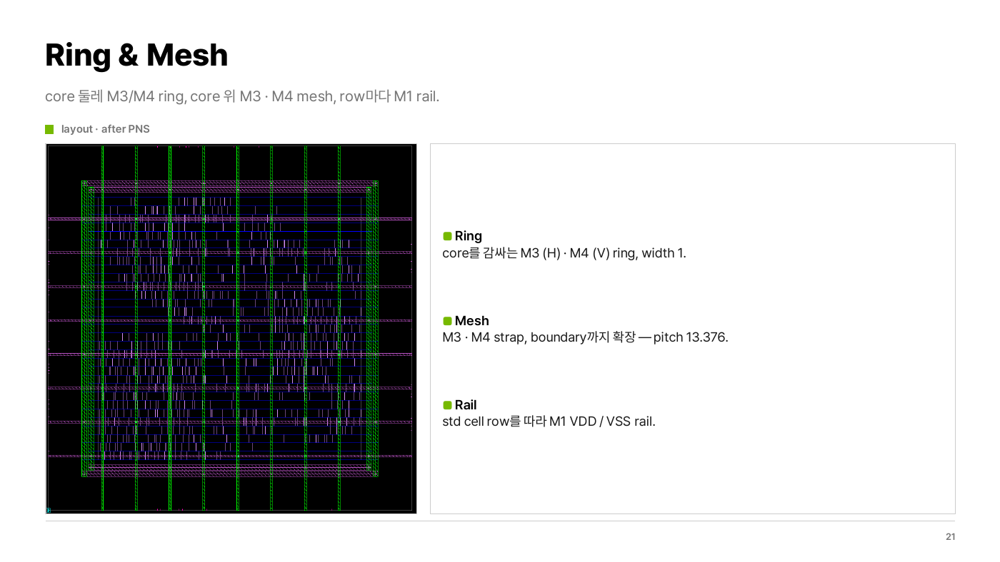

### 문제 1 — 특정 corner에 I/O constraint 미적용 (TCK-012)
- **현상**: pre-placement `check_design`에서 TCK-012 warning 34개
- **원인 분석**: fast corner scenario에 input delay 미적용
- **해결**: scenario 전환 후 constraint를 다시 source → 34 → 2 (의도적으로 미지정한 reset만 잔여)

### 문제 2 — Route 후 zroute error 21건
- **현상**: error가 OR / NOR gate cell에 집중, pin 위 VIA1 · M2 연결이 off-grid
- **원인 분석**: 해당 cell의 reference library 문제로 확인
- **해결**: 수정된 reference library로 교체 후 동일 flow 재실행 → DRC 0

| 현상 | 원인 |
|---|---|
| 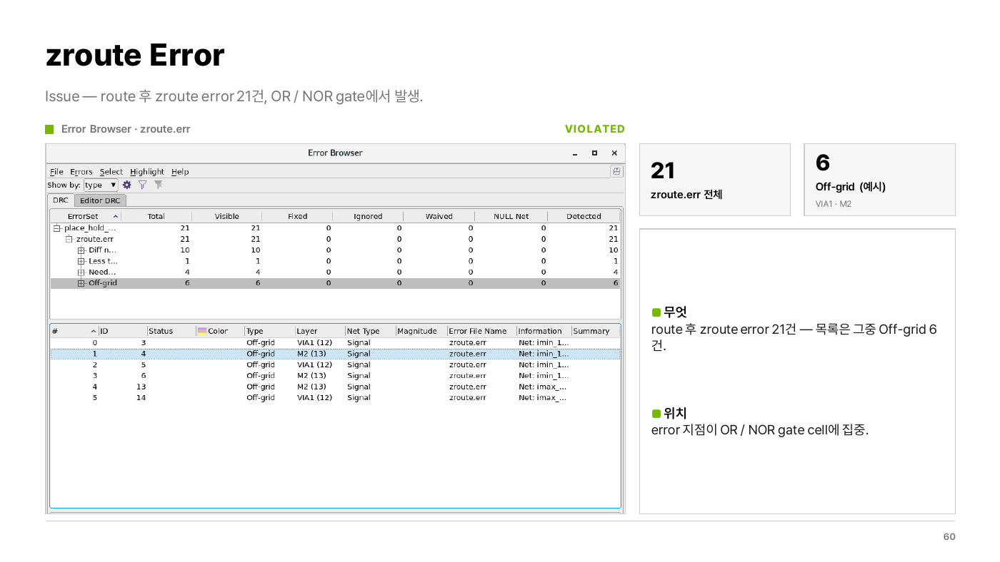 | 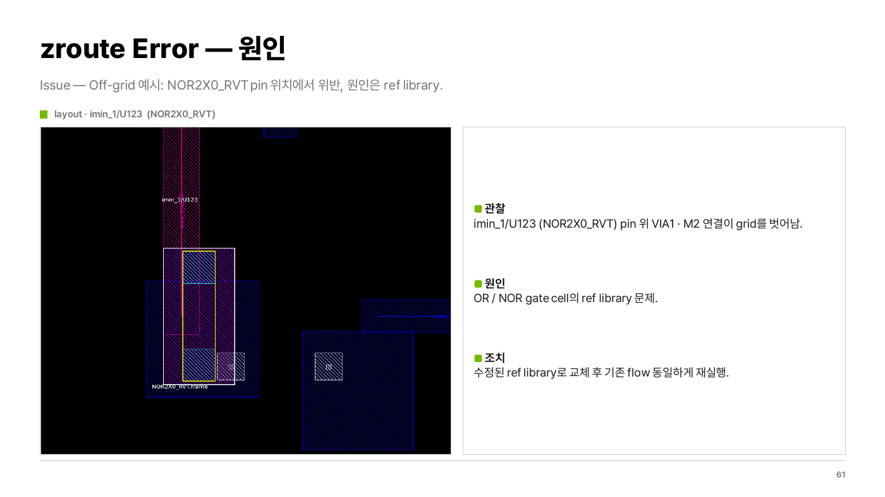 |

### 단계별 QoR

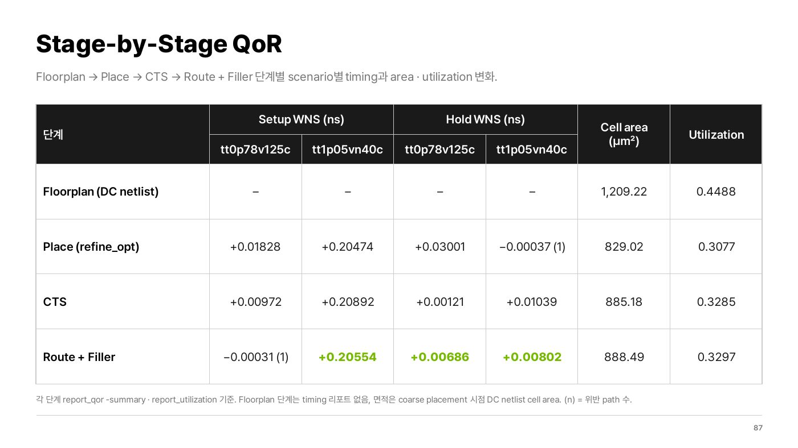

### 최종 Layout (Filler 삽입 후)

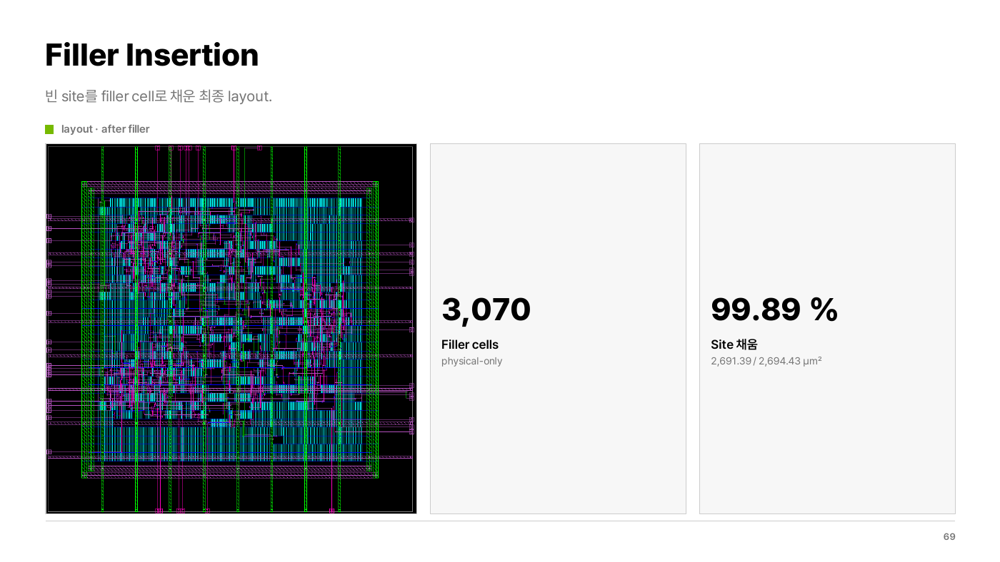

 

## 배운 점
매 단계 `check_design`의 warning을 그냥 넘기지 않고 원인을 하나씩 확인했고, 그 과정에서 fast corner에 constraint가 빠진 문제(TCK-012)를 Place 전에 찾을 수 있었습니다.

Tool 결과만 보지 않고 layout에서 직접 위치를 확인해야 원인(ref library)을 찾을 수 있었습니다.

## 다음 단계
StarRC로 SPEF 추출 → PrimeTime STA 및 잔여 setup 1 path ECO → floorplan DEF를 반영한 2nd-pass 합성
