# CISC: Synthesis → Sign-off (Half-cycle 경로 Timing Closure)

[← 메인으로](../)

8-bit CISC 마이크로프로세서를 **합성부터 P&R, StarRC · PrimeTime ECO, Sign-off까지** 진행한 프로젝트입니다.
반전 clock(clk′)으로 동작하는 메모리로 인해 생긴 **half-cycle 경로**를 합성 단계에서 critical path로 찾아냈고, back-end에서도 같은 경로가 끝까지 남아 PT 자동 ECO로 해결되지 않자 **수동 ECO로 직접 닫았습니다.**

| 항목 | 내용 |
|---|---|
| 기간 | 2026 (KDT AI 시스템 반도체 설계 과정) |
| 설계 | 8-bit CISC (Controller, Memory, Bidirectional bus, Dual-phase clock) |
| Spec | 714 MHz (1.4 ns), LVT < 25 % (recommendation 28 %), L-shape boundary |
| 라이브러리 | SAED32 32nm (합성은 180nm · 130nm 비교 포함) |
| Tool | Design Compiler, Formality, VCS, IC Compiler II, StarRC, PrimeTime (DMSA) |
| 상세 자료 | [합성 (DC) PDF](docs/CISC_Synthesis.pdf) · [Back-end (ICC2 · StarRC · PT) PDF](docs/CISC_PnR_ICC2.pdf) |


<br>

## 결과 요약

### Synthesis (1.4 ns, Hierarchical)

| 항목 | 1.4 ns (spec) | 1.29 ns (spec-up) |
|---|---|---|
| Timing | MET | Reg-to-reg MET, Output WNS −0.048 ns (허용 −0.05 이내) |
| Cell area | 2,231 µm² | 2,355 µm² |
| LVT 비율 | 24.8 % | 26.9 % |
| Total power | 1.12 mW | 1.38 mW |
| Formality | PASS | PASS |

### Back-end Sign-off (1.4 ns netlist, 4 scenario)

| 항목 | tt0p78v125c | tt1p05vn40c | ff0p85v125c | ff1p16vn40c |
|---|---|---|---|---|
| Setup WNS (ns) | +0.00027 | +0.04312 | +0.02260 | +0.08907 |
| Hold WNS (ns) | +0.13797 | +0.07940 | +0.08163 | +0.03854 |

| 항목 | 결과 |
|---|---|
| 최종 PrimeTime (DMSA, PBA exhaustive) | setup · hold · constraint 위반 없음 |
| check_routes DRC / open | 0 / 0 (932 nets) |
| LVS short / open / floating | 0 / 0 / 0 |
| PG floating · missing via | 0 · 0 / 0 |
| Cell area (netlist / +physical) | 2,265.44 / 5,069.92 µm², utilization 0.4451 |
| LVT (logic cell) | 28.30 % (249 / 880) — timing 확보를 위한 trade-off |

<br>

## Part 1. Synthesis (Design Compiler)

### 핵심 1 — Half-cycle 경로 Timing Closure

- Controller(`top_mc1`)는 clk, 메모리(`mem1`)는 반전 clock(clk′)으로 동작 → controller에서 메모리로 가는 경로는 주기 1.4 ns가 아니라 **절반인 0.7 ns** 안에 도착 필요
- 이 경로가 32nm 전체의 **critical path**

| 항목 | 값 |
|---|---|
| Startpoint → Endpoint | `top_mc1/state1/state_out_reg[2]` → `mem1/xn1_reg[6]` |
| Capture edge | clk′ rise **0.700 ns** (half cycle) |
| Data arrival / required | 0.857771 / 0.857918 ns |
| Slack | **+0.000147 ns (MET)** |

spec(1.4 ns)을 만족한 뒤 주기를 줄이며 어디까지 닫히는지 확인했습니다. 주기가 줄면 half-cycle 예산도 함께 줄어듭니다 (1.29 ns 주기에서는 0.645 ns).

| 주기 | Reg-to-reg | Output WNS | 목표(−0.05 ns) 대비 |
|---|---|---|---|
| 1.29 ns | MET | −0.048 ns | **PASS** |
| 1.28 ns | MET | −0.051 ns | FAIL |

- **PPA trade-off**: Performance를 얻는 대신 LVT 24.8 % → 26.9 % (leakage 증가), area 2,231 → 2,355 µm², power 1.12 → 1.38 mW

| Half-cycle 경로 | 1.29 ns vs 1.28 ns |
|---|---|
|  | 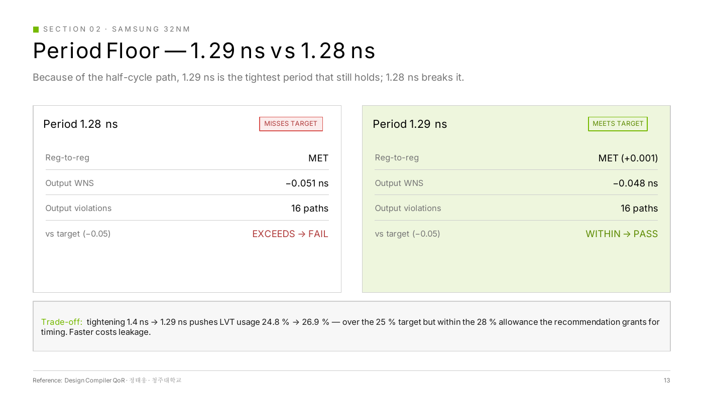 |

### 핵심 2 — Retiming이 레지스터를 삭제한 문제

- **현상**: global retiming(`set_optimize_registers true`)을 켜자 `mem1/temp_reg`가 redundant로 판단되어 삭제 → Formality **20 failing + 41 unverified**
- **원인**: `set_dont_retime`은 레지스터의 **이동**만 방지하고 **삭제**는 방지 불가. mapping 전에 `dont_touch`를 걸면 mapping 자체가 차단
- **해결**

```
compile_ultra -only_map           # mapping만 먼저 수행 → temp_reg가 실제 cell로 존재
set_dont_touch mem1/temp_reg      # 이후 최적화에서 보호
compile_ultra -retime -incremental
```
→ Formality **122 passing, 0 failing**

| 실패 | 해결 |
|---|---|
|  | 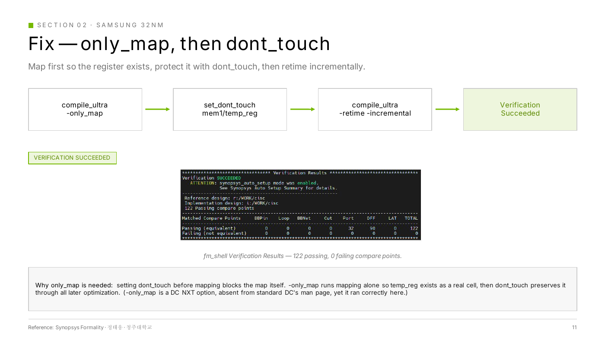 |

<br>

## Part 2. Back-end (IC Compiler II · StarRC · PrimeTime)

### Flow

```
Setup & Scenario → Floorplan + PNS → Place → CTS → Route
  → StarRC (SPEF) → PrimeTime DMSA → ICC2 ECO   (2회 반복)
  → Filler → 최종 PrimeTime 확인
```

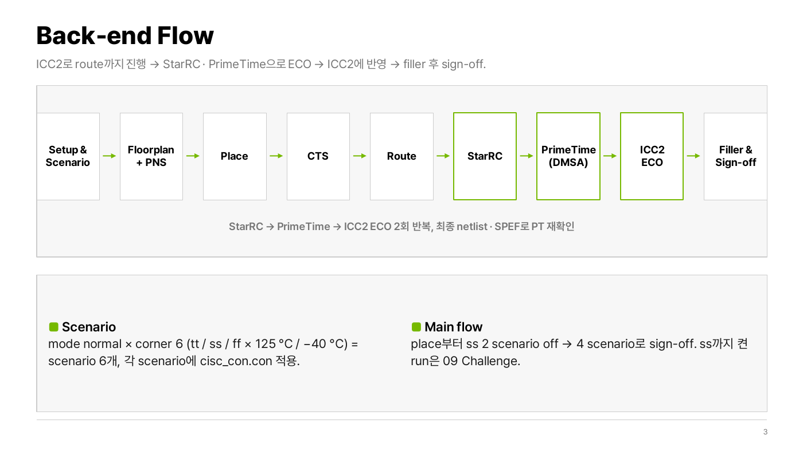

- **MCMM**: 1 mode × 6 corner(tt / ss / ff × 125 °C / −40 °C) 정의. place부터 ss 2 scenario는 off, **4 scenario로 sign-off** (ss는 Challenge로 별도 시도)
- **Floorplan**: L-shape die(72 × 84 µm), pin side만 core offset 3, 나머지 0으로 core 면적 최소 손실. 더 줄이면 route error 발생
- **Power Plan**: M3(H) / M4(V) ring · mesh(pitch 13.376), M1 rail, rail × M4 strap 교차점 stacked via, PG check 위반 0
- **Place**: half-cycle 경로를 별도 path group(`HC_P2N`, `HC_N2P`, weight 2)으로 묶어 집중 최적화

| L-shape Floorplan | Clock QoR (CCD) |
|---|---|
| 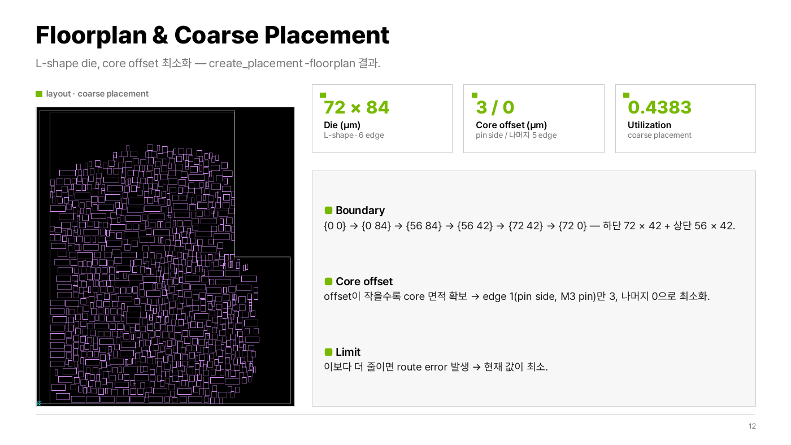 | 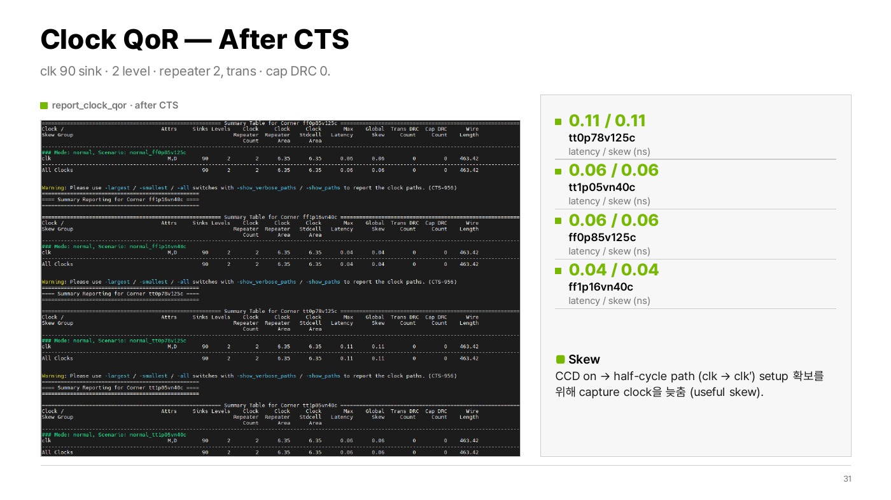 |

### CTS 전략 — Classic CTS 대신 CCD

- Classic CTS(skew balancing)로는 half-cycle(clk → clk′) 경로의 setup을 맞출 수 없어 **CCD(Concurrent Clock and Data)로 useful skew**를 사용, capture clock을 늦춰 setup 여유 확보
- skew balancing도 중요하지만 **timing을 우선**한 선택 → CTS 후 4 scenario setup · hold 위반 0 (place 후 −0.04325 / 23 path 해소)
- 대가로 clock latency 0.04 – 0.11 ns로 insertion delay spec(150 ± 5 ps)은 미충족 — **trade-off**
- 참고: half-cycle 경로가 없는 [Error Detection Code Block](../01_ErrorDetection_Synthesis_PnR/)에서는 balanced tree를 목표로 CCD를 끄고 진행 → **설계 구조에 따라 CTS 전략을 다르게 선택**

### Issue ① — PT 자동 ECO로 해결되지 않은 half-cycle setup 위반

Route 후 tt0p78v125c에서 half-cycle 경로(`HC_P2N`) setup −0.00706 ns 1 path가 남았고, StarRC SPEF 기반 PrimeTime DMSA의 `fix_eco_timing`은 **위반 endpoint 2개를 찾고도 0개 수정**했습니다. 그래서 위반 경로를 직접 분석해 단계적으로 수동 ECO를 적용했습니다.

| 단계 | 분석 | 조치 | Worst slack (ns) |
|---|---|---|---|
| 1 | `mux_out[0]` net에 load 11개, 그중 `U171`(INVX8_LVT) pin cap이 최대 | `U171` → INVX4_LVT size down (PT ECO) | −0.00643 (PT) → −0.00443 (ICC2 반영 후) |
| 2 | load별 slack scan → 11개 중 `U154/A1`, `U171/A` 2개만 위반 | MUX21X2_LVT **clone**을 만들어 위반 load 2개만 새 net으로 분리 | −0.00677 (worst path가 U154 경로로 이동) |
| 3 | `U154/Y`를 지나는 경로 중 `mem_data2_reg[5]` 1개만 위반 | OR2X2_LVT **clone**으로 해당 load만 분리 | +0.00092 |
| 4 | 같은 경로의 NOR3X0_RVT `U10` delay 0.094 ns | `U10` → NOR3X0_LVT **Vt swap**으로 마진 확보 | **+0.00032 (4 scenario 위반 0)** |

- 전체 net을 건드리지 않고 **위반 load만 골라 분리**해 다른 경로에 영향을 최소화
- 이후 StarRC · DMSA로 다시 분석해 setup · hold · constraint 위반 없음 확인

| PT 자동 ECO 후 남은 위반 경로 | Load별 slack scan |
|---|---|
| 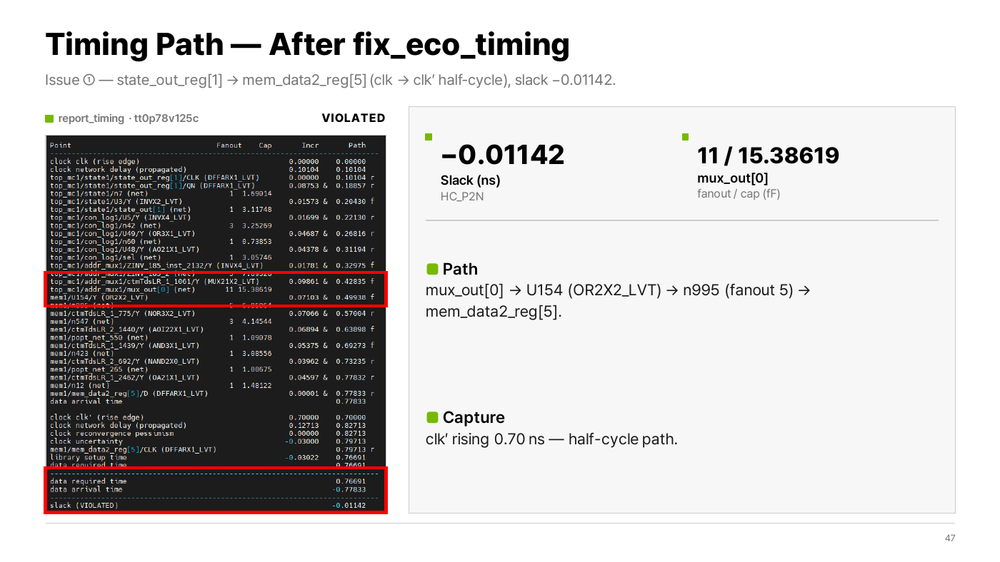 | 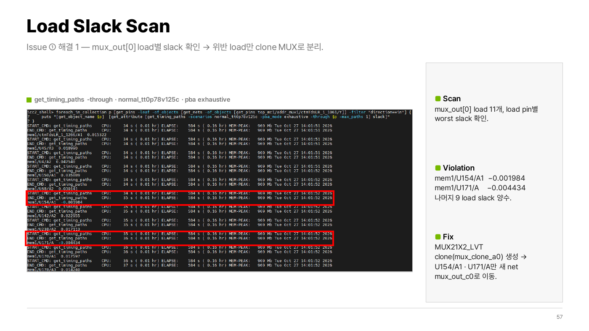 |

| Clone 후 위반 해소 | ECO 후 QoR |
|---|---|
| 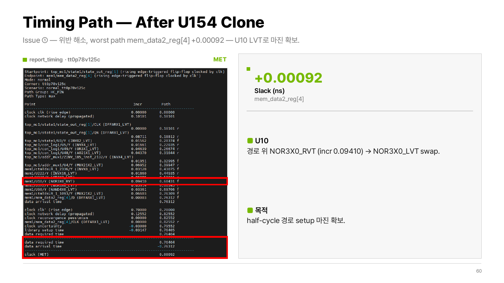 | 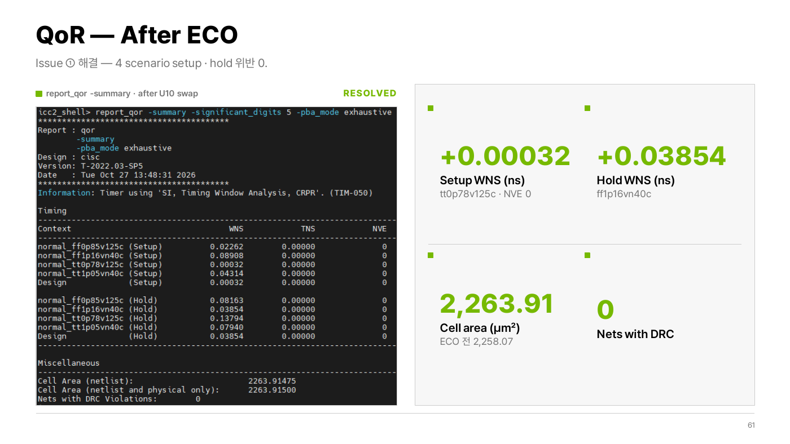 |

### Issue ② — ECO 적용 후 route DRC 10

- 최종 PT에서 위반이 없는 상태로 `fix_eco_timing` 결과 tcl을 ICC2에 적용하자 **M1 route DRC 10개**(Short 6, Less than minimum enclosed area 4) 발생
- ECO로 바뀐 cell 주변 M1 배선 문제 → error net과 via를 수동 삭제 후 `route_eco -open_net_driven true`로 재배선 → **DRC 10 → 0**

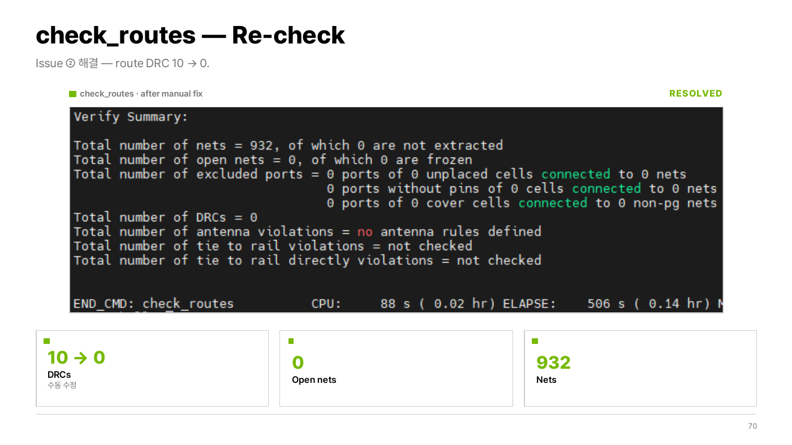

### 단계별 QoR

| 단계 | Setup WNS tt0p78 | tt1p05 | ff0p85 | ff1p16 | Hold WNS | Cell area (µm²) | Util. |
|---|---|---|---|---|---|---|---|
| Floorplan | – | – | – | – | – | 2,230.62 | 0.4383 |
| Place | −0.04325 (23) | +0.03151 | +0.00848 | +0.07045 | – | 2,333.04 | 0.4584 |
| CTS | +0.00017 | +0.04441 | +0.02505 | +0.09029 | +0.03779 | 2,242.06 | 0.4406 |
| Route | −0.00706 (1) | +0.04319 | +0.02268 | +0.08910 | +0.03852 | 2,253.24 | 0.4427 |
| ECO | +0.00032 | +0.04314 | +0.02262 | +0.08908 | +0.03854 | 2,263.91 | 0.4448 |
| Filler (final) | +0.00027 | +0.04312 | +0.02260 | +0.08907 | +0.03854 | 2,265.44 | 0.4451 |

(n) = 위반 path 수, Route 이후 PBA exhaustive 기준

| 최종 Layout (Filler 후) | 최종 결과 |
|---|---|
| 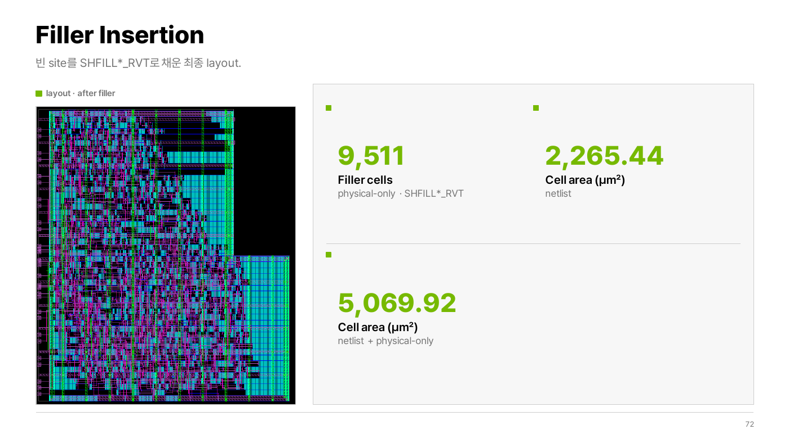 | 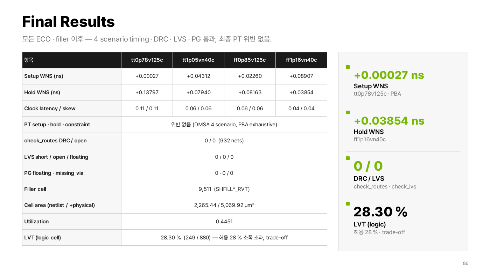 |

### Trade-off 정리

| 항목 | Spec | 결과 | 이유 |
|---|---|---|---|
| LVT 비율 (logic) | < 25 % (recommendation 28 %) | 28.30 % | half-cycle 경로 timing 확보를 위한 LVT ECO |
| Clock insertion delay | 150 ± 5 ps | 0.04 – 0.11 ns | half-cycle 경로를 위한 CCD useful skew |

### Challenge — ss corner까지 closure 시도

ss 2 scenario까지 켜고 place → CTS → route를 진행했지만, ss0p7v125c(0.70 V, 125 °C)에서 route 후 setup WNS −0.85397 ns(90 path)로 ECO로 메울 수 없는 위반폭이 남아 **메인 결과는 ss off 기준**으로 진행했습니다.

<br>

## 공정별 비교 (Synthesis)

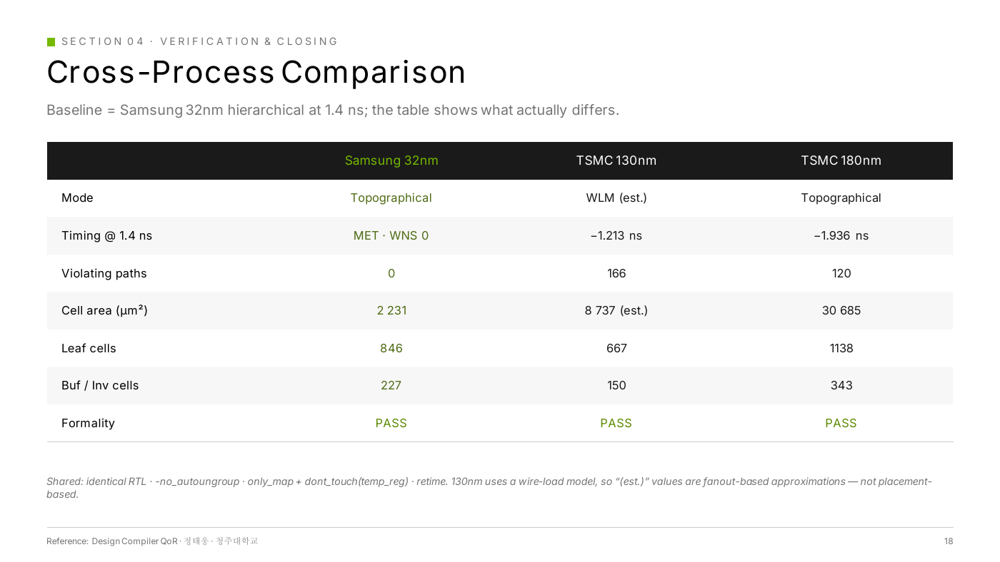

- 다른 공정으로 옮길 때 spec의 출력 부하가 SAED32 셀 기준으로 정의되어 있어, 대상 라이브러리의 pin capacitance와 단위(fF ↔ pF)를 확인해 값을 다시 설정
- 180nm · 130nm는 1.4 ns에서 WNS −1.9 / −1.2 ns로 공정 속도 자체의 한계 확인

<br>

## 배운 점
반전 clock(clk′)으로 동작하는 메모리로 인해 생긴 half-cycle 경로는 합성부터 sign-off까지 따라다니는 문제였고, 단계마다 다른 방법(path group, CCD, 수동 ECO)으로 대응해야 했습니다.

Tool의 자동 ECO가 실패해도 경로를 load 단위로 쪼개서 보면 해결 방법을 찾을 수 있다는 것을 경험했습니다.

timing을 위해 LVT 비율과 clock latency를 내준 것처럼, sign-off는 모든 지표를 만족시키는 일이 아니라 우선순위를 정하고 그 근거를 설명하는 일이라는 것을 배웠습니다.

Retiming과 equivalence check는 따로 생각할 수 없고, 보존 전략을 함께 설계해야 합니다.
