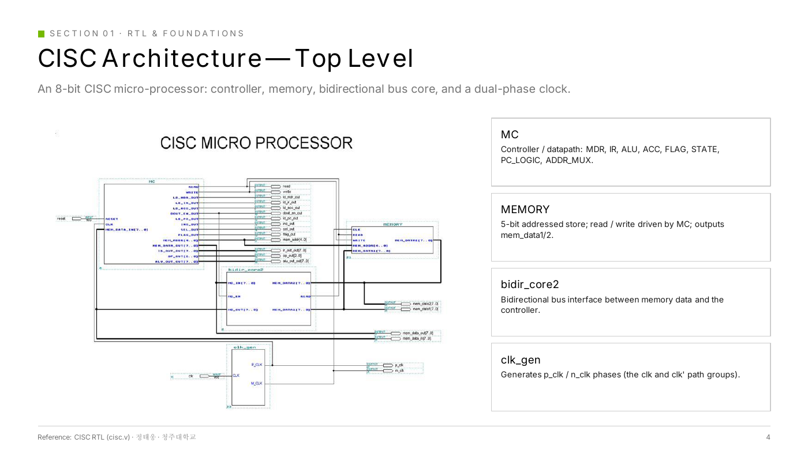
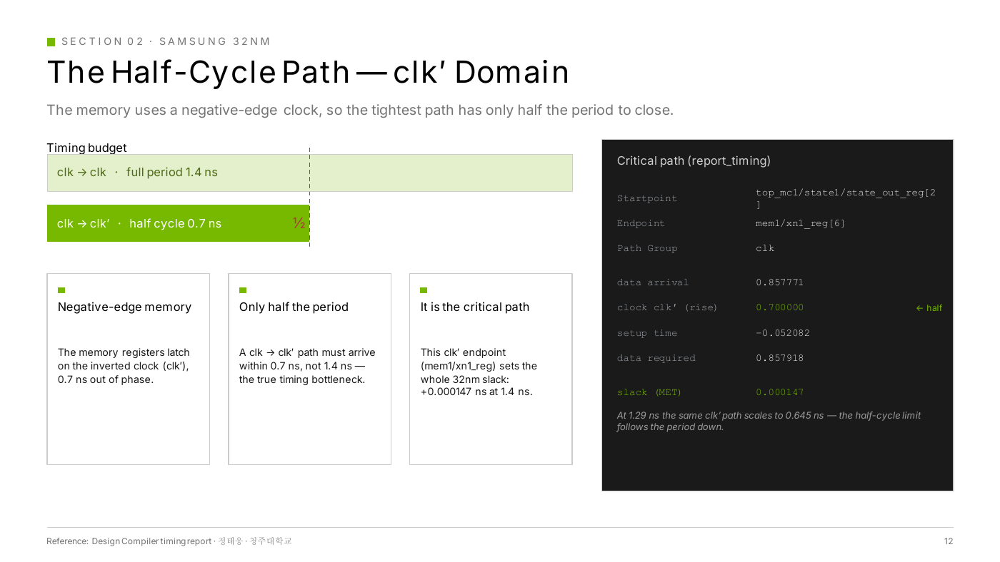
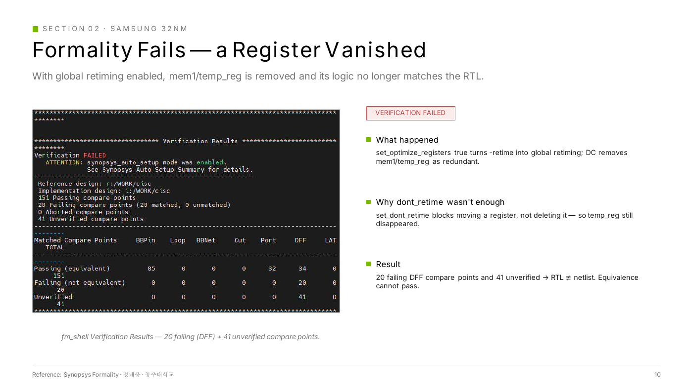

# CISC 합성: Half-cycle 경로 Timing Closure

[← 메인으로](../)

8-bit CISC 마이크로프로세서를 3개 공정에서 합성하면서, **반전 clock을 쓰는 메모리 때문에 생긴 half-cycle 경로**를 critical path로 찾아내고 timing을 닫은 뒤, 그 경로가 정하는 **주기 하한**까지 확인한 프로젝트입니다.

| 항목 | 내용 |
|---|---|
| 기간 | 2026 (KDT AI 시스템 반도체 설계 과정) |
| 설계 | 8-bit CISC (Controller, Memory, Bidirectional bus, Dual-phase clock) |
| Spec | 714 MHz (1.4 ns), LVT < 25 % (timing 목적 28 %까지 허용) |
| 라이브러리 | SAED32 32nm, 180nm, 130nm |
| Tool | Design Compiler, Formality, VCS |
| 상세 자료 | [발표 자료 PDF](docs/CISC_Synthesis.pdf) |



<br>

## 결과 요약 (SAED32 32nm, Hierarchical)

| 항목 | 1.4 ns (spec) | 1.29 ns (하한) |
|---|---|---|
| Timing | MET | Reg-to-reg MET, Output WNS −0.048 ns (허용 −0.05 이내) |
| Cell area | 2,231 µm² | 2,355 µm² |
| LVT 비율 | 24.8 % | 26.9 % (28 % 허용 범위) |
| Total power | 1.12 mW | 1.38 mW |
| Formality | PASS | PASS |

<br>

## 핵심 1 — Half-cycle 경로 Timing Closure

### 구조 분석
- Memory 레지스터는 반전 clock(clk′)에서 latch → controller(clk)에서 memory(clk′)로 가는 경로는 주기 1.4 ns가 아니라 **절반인 0.7 ns** 안에 도착해야 함
- 이 경로가 32nm 전체의 **critical path**

| 항목 | 값 |
|---|---|
| Startpoint → Endpoint | `top_mc1/state1/state_out_reg[2]` → `mem1/xn1_reg[6]` |
| Capture edge | clk′ rise **0.700 ns** (half cycle) |
| Data arrival / required | 0.857771 / 0.857918 ns |
| Slack | **+0.000147 ns (MET)** |

### 주기 하한 탐색
spec(1.4 ns)을 만족한 뒤, 주기를 줄이며 어디까지 닫히는지 확인했습니다. 주기가 줄면 half-cycle 예산도 함께 줄어듭니다 (1.29 ns 주기에서는 0.645 ns).

| 주기 | Reg-to-reg | Output WNS | 목표(−0.05 ns) 대비 |
|---|---|---|---|
| 1.29 ns | MET | −0.048 ns | **PASS** |
| 1.28 ns | MET | −0.051 ns | FAIL |

- **하한 1.29 ns**: 1.28 ns부터 허용치를 넘음
- **PPA trade-off**: Performance를 얻는 대신 LVT 24.8 % → 26.9 % (leakage 증가, 28 % 허용 범위 이내), area 2,231 → 2,355 µm², power 1.12 → 1.38 mW

| Half-cycle 경로 | 1.29 ns vs 1.28 ns |
|---|---|
|  |  |

<br>

## 핵심 2 — Retiming이 레지스터를 삭제한 문제

timing을 개선하려고 global retiming을 켜자 등가성 검사가 실패했습니다.

### 현상
`set_optimize_registers true`로 global retiming을 켜자 `mem1/temp_reg`가 redundant로 판단되어 삭제됨
→ Formality **20 failing + 41 unverified** compare points, RTL ≢ netlist

### 원인 분석
- `set_dont_retime`은 레지스터의 **이동**만 막고 **삭제**는 막지 못함
- mapping 전에 `dont_touch`를 걸면 mapping 자체가 막힘

### 해결
```
compile_ultra -only_map           # mapping만 먼저 수행 → temp_reg가 실제 cell로 존재
set_dont_touch mem1/temp_reg      # 이후 최적화에서 보호
compile_ultra -retime -incremental
```
→ Formality **122 passing, 0 failing**

| 실패 | 해결 |
|---|---|
|  |  |

<br>

## 공정별 비교


- 다른 공정으로 옮길 때 spec의 출력 부하가 SAED32 셀 기준으로 정의되어 있어, 대상 라이브러리의 pin capacitance와 단위(fF ↔ pF)를 확인해 값을 다시 설정
- 180nm · 130nm는 1.4 ns에서 WNS −1.9 / −1.2 ns로 공정 속도 자체의 한계 확인

<br>

## 배운 점
- 회로 구조(반전 clock 메모리)가 timing 예산을 절반으로 줄이고, 결국 설계 전체의 주기 하한을 정한다는 것을 리포트로 확인했습니다.
- 주기를 줄이는 것에는 LVT 비율 · area · power라는 비용이 따르며, 그 trade-off를 수치로 판단해야 한다는 것을 배웠습니다.
- Retiming과 equivalence check는 따로 생각할 수 없고, 보존 전략을 함께 설계해야 합니다.
