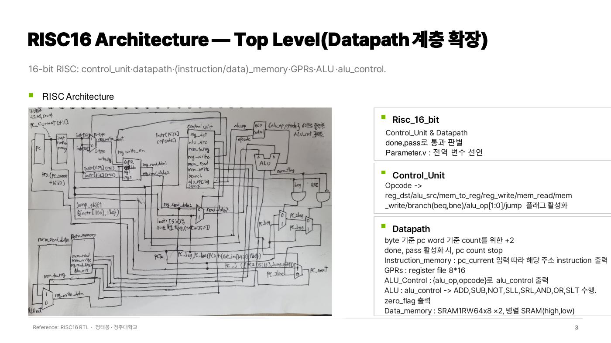
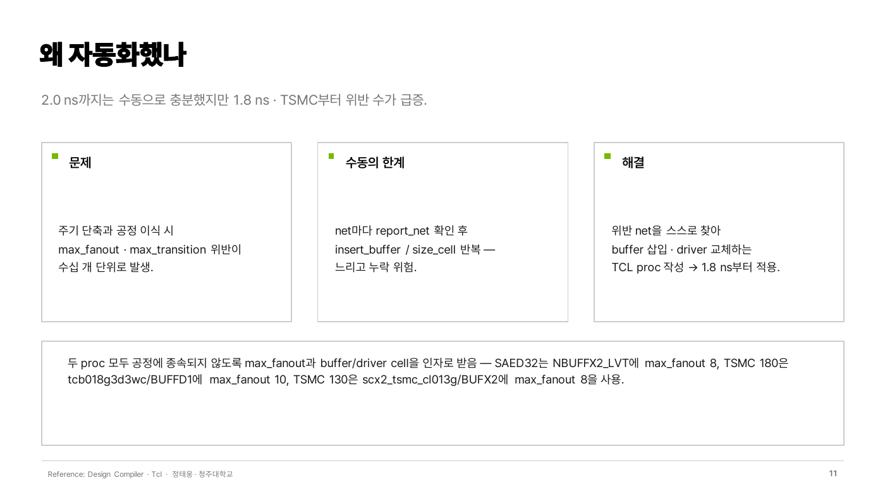
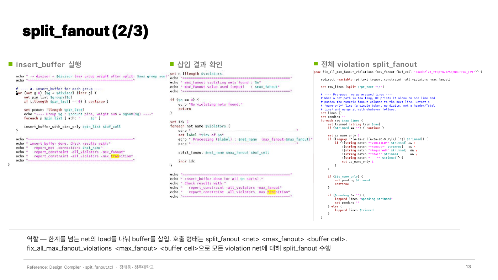
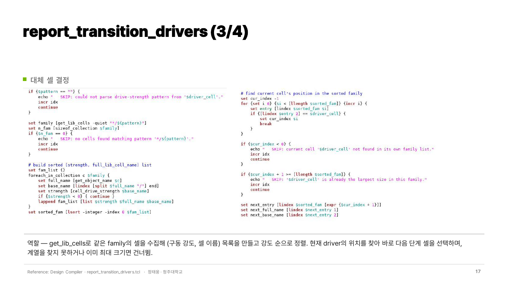
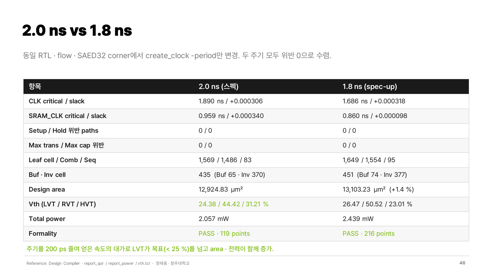
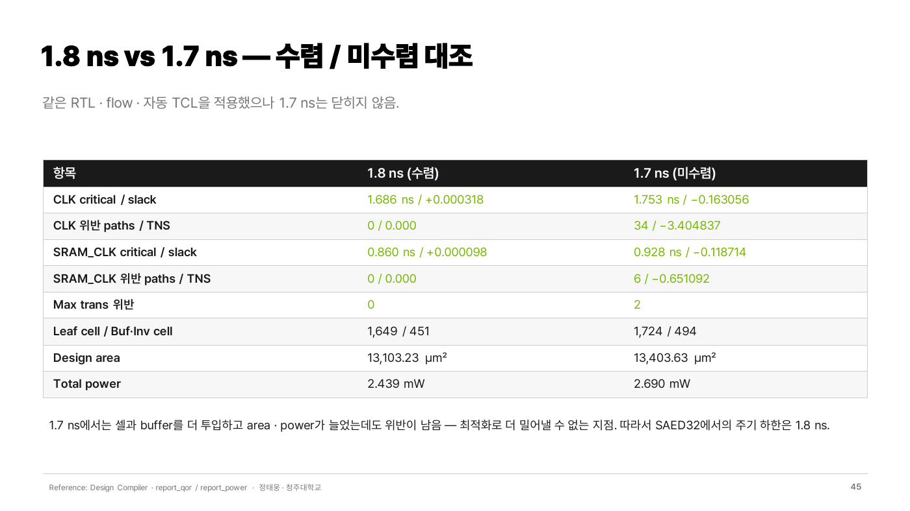
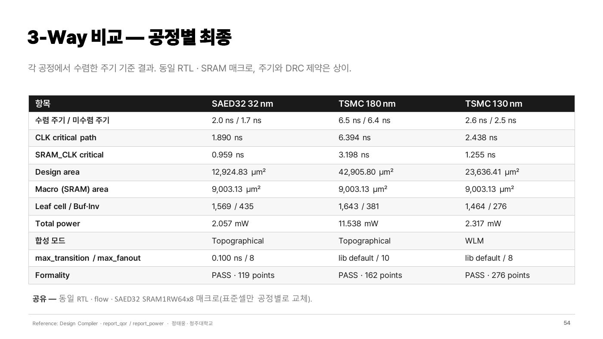

# RISC16 + SRAM 합성 & TCL 자동화

[← 메인으로](../)

16-bit RISC 프로세서(dual SRAM data memory)를 3개 공정에서 합성하고, 반복되는 DRC 위반 수정을 **TCL proc로 자동화**한 프로젝트입니다.

| 항목 | 내용 |
|---|---|
| 기간 | 2026 (KDT AI 시스템 반도체 설계 과정) |
| 설계 | 16-bit RISC (Control Unit, Datapath, GPR 8×16, ALU), SRAM1RW64x8 × 2 (16-bit data memory) |
| 라이브러리 | SAED32 32nm, 180nm, 130nm |
| Tool | Design Compiler (Topographical / WLM), Formality, VCS |
| 역할 | Testbench 작성, 합성 제약 및 위반 수정, **자동화 TCL 작성**, 공정별 주기 하한 탐색 |
| 상세 자료 | [발표 자료 PDF](docs/RISC16_Synthesis.pdf) |

 

## 결과 요약

| 항목 | SAED32 32nm | 180nm | 130nm (WLM) |
|---|---|---|---|
| 수렴 주기 / 미수렴 주기 | 2.0 ns (도전 1.8 ns 수렴) / 1.7 ns | 6.5 ns / 6.4 ns | 2.6 ns / 2.5 ns |
| Design area | 12,924.83 µm² | 42,905.80 µm² | 23,636.41 µm² |
| Total power | 2.057 mW | 11.538 mW | 2.317 mW |
| Formality | PASS (119 points) | PASS (162 points) | PASS (276 points) |

모든 수렴 주기에서 setup · hold · max_trans · max_cap 위반 0

 

## 핵심 1 — 위반 수정 자동화 (TCL)

**왜 만들었나**: 2.0 ns까지는 수동으로 충분했지만, 주기를 줄이거나 공정을 바꾸면 max_fanout · max_transition 위반이 수십 개 단위로 생겨 `report_net` 확인 → `insert_buffer` / `size_cell`을 반복하는 방식으로는 느리고 누락 위험이 있었습니다.

### `split_fanout`
- `report_net -connections` 결과를 파싱해 위반 net의 load pin 목록 추출
- max_fanout을 넘는 load를 나눠 buffer 삽입, `report_constraint`에 위반이 없어질 때까지 반복
- 사용: `fix_all_max_fanout_violations_loop <max_fanout> <buffer_cell>`

### `report_transition_drivers`
- 줄바꿈으로 잘린 report 라인을 합친 뒤 max_transition 위반 net 수집
- 각 net의 driver cell을 찾고, 셀 이름에서 구동 강도를 추출
- 같은 family 셀을 강도 순으로 정렬해 **한 단계 큰 셀로 `size_cell`**

> 두 proc 모두 max_fanout 값과 buffer / driver cell을 인자로 받도록 만들어 공정이 바뀌어도 그대로 사용했습니다.
> (SAED32: max_fanout 8 / 180nm: 10 / 130nm: 8)

 

## 핵심 2 — Spec-up을 통한 PPA trade-off 분석

spec(2.0 ns)을 만족한 뒤, 같은 RTL · flow에서 `create_clock -period`만 줄여 **어디까지 닫히는지, 그 비용은 무엇인지** 확인했습니다.

| 항목 | 2.0 ns (spec) | 1.8 ns | 1.7 ns |
|---|---|---|---|
| Setup 위반 | 0 | 0 | CLK 34 paths, WNS −0.163 ns |
| LVT 비율 | 24.38 % | 26.47 % (목표 25 % 초과) | |
| Area | 12,924.83 µm² | 13,103.23 µm² | 13,403.63 µm² |
| Power | 2.057 mW | 2.439 mW | 2.690 mW |

- **병목**: SRAM이 반전 clock(`~clk`)을 쓰기 때문에 SRAM_CLK 경로의 timing 예산은 주기의 절반
- **결론**: 1.7 ns는 셀과 buffer를 더 넣어도 위반이 남는 구조적 한계 → SAED32에서의 하한은 1.8 ns
- 180nm는 timing은 닫혔지만 fanout 위반 1개가 남아 6.5 ns, 130nm는 SRAM_CLK half-cycle 경로에서 2.6 ns가 하한

| 2.0 ns vs 1.8 ns | 1.8 ns vs 1.7 ns |
|---|---|
|  |  |

 

## 공정별 PPA 비교

- 32nm와 180nm는 Topographical(tech DB 기반 RC), 130nm는 tech DB가 없어 WLM(fanout 기반 추정)으로 합성 → 130nm 수치는 참고치로 해석
- 180nm는 32nm용 max_transition(0.100 ns)이 셀 특성에 비해 과하게 엄격해 라이브러리의 `default_max_transition`을 사용

 

## 배운 점
같은 작업을 세 번 이상 반복하게 되면 스크립트로 만드는 것이 속도뿐 아니라 누락을 막는 데에도 효과적이었습니다.

주기를 줄이면 timing은 맞춰도 LVT 비율 · area · power가 함께 늘어나는 trade-off를 수치로 확인했습니다.
