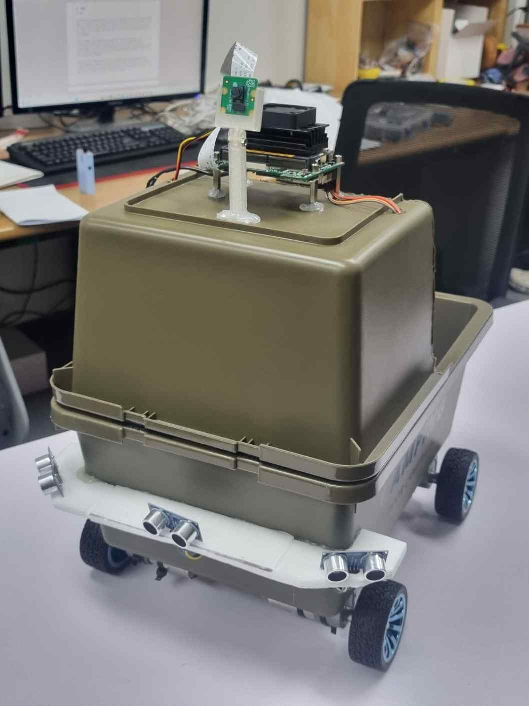
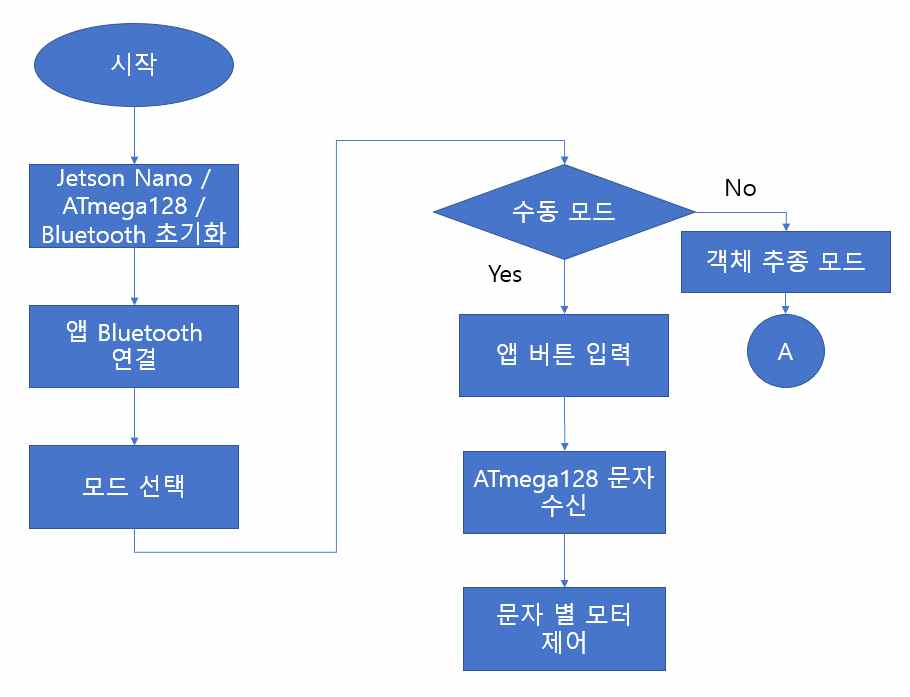
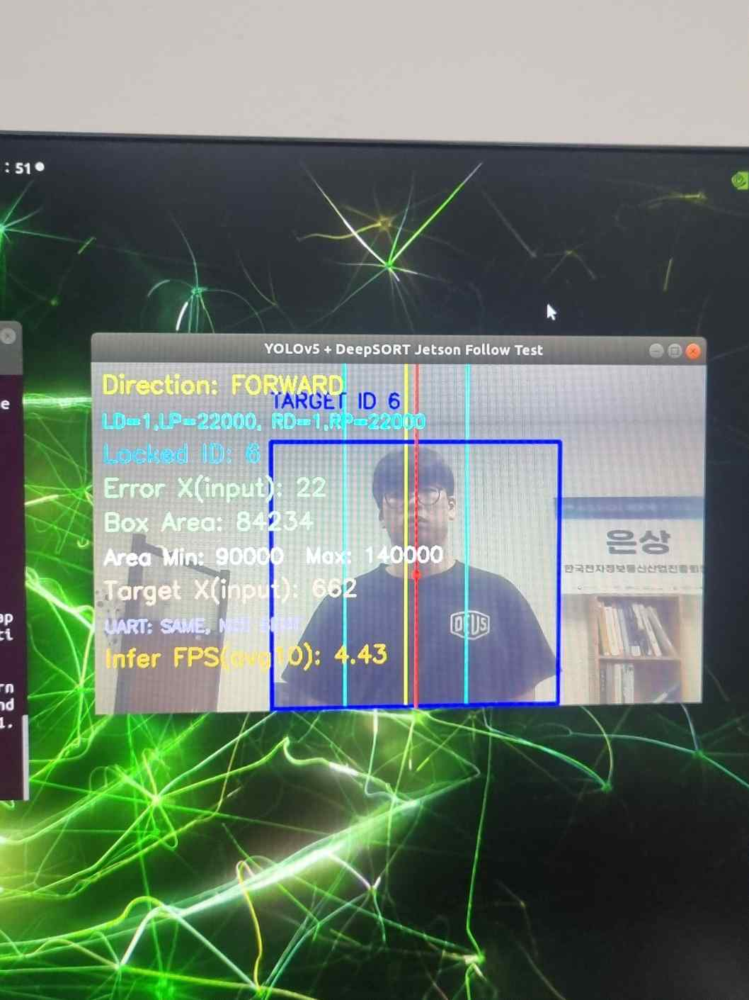

# YOLOv5 기반 객체 추종 및 장애물 회피 운반 로봇 (졸업작품)

[← 메인으로](../)

카메라로 사용자를 인식해 따라가며 짐을 운반하고, 초음파 센서로 장애물을 회피하는 로봇입니다.

| 항목 | 내용 |
|---|---|
| 기간 | 2026.01 ~ 2026.05 (2인 팀) |
| 상위 제어 | NVIDIA Jetson Nano (Ubuntu 18.04), YOLOv5 + DeepSORT |
| 하위 제어 | ATmega128, PWM 모터 제어, 초음파 센서 3개 (전방 · 좌전방 · 우전방) |
| 통신 | Jetson ↔ ATmega128 UART, 스마트폰 앱 ↔ 로봇 Bluetooth |
| 담당 | Jetson Nano 환경 구축, 객체 인식 · 추적 구현, 시스템 통합 |
| 상세 자료 | [최종 보고서 PDF](docs/YOLOv5_Robot_Report.pdf) |

 

## 시스템 구성

1. YOLOv5로 사람 객체 검출, DeepSORT Re-ID로 특정 사용자를 지속 추적
2. Bounding box의 위치 · 크기로 사용자의 방향과 거리를 판단해 주행 명령 생성
3. 주행 명령을 UART 패킷으로 ATmega128에 전송 → 좌우 모터 PWM 제어
4. 장애물 감지 시 추종보다 **회피 동작 우선**, 모든 방향이 막히면 후진
5. 앱에서 수동 / 추종 모드 전환, 타겟 재지정

 

## 결과

| 평가 항목 | 결과 |
|---|---|
| 객체 인식 | 성공 — bounding box 안정적으로 유지 |
| 객체 추종 | 보통 — 방향 보정 · 전진 · 정지 동작은 수행, 일부 프레임 저하로 안정성 부족 (약 4~5 FPS) |
| 수동 제어 | 성공 |
| 장애물 회피 | 성공 — 충돌 없이 회피 |

## 한계와 개선 방향
- Jetson Nano에서 추론 속도가 낮아 추종이 끊기는 구간 발생 → 모델 경량화, 추적 주기 최적화 필요
- 초음파 센서는 각도 · 재질에 따라 오차 발생 → LiDAR 또는 Depth camera 적용 검토
