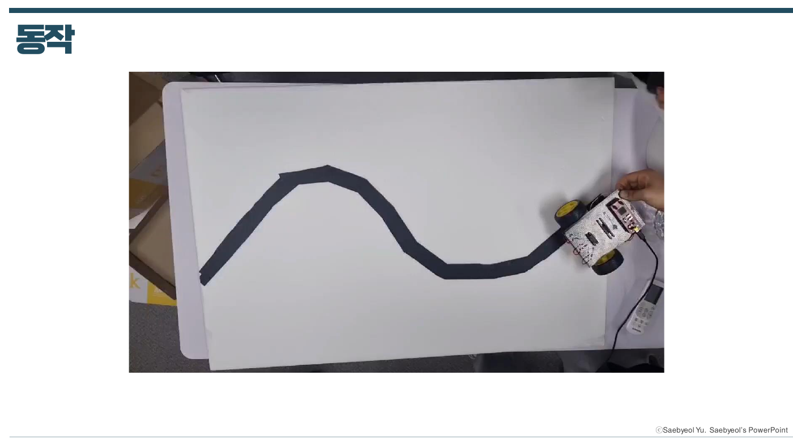

# 임베디드 로봇 프로젝트 (학부연구생)

[← 메인으로](../)

청주대학교 SNSLAB 학부연구생 활동으로, **하나의 ATmega128 로봇에 기능을 단계적으로 추가**하며 센서 · 통신 · 모터 제어를 직접 구현했습니다.
라인트레이서로 시작해 초음파 센서 장애물 회피, 블루투스 원격 조종을 거쳐, 마지막에는 직접 만든 Android 앱으로 조종하는 BLE RC카로 확장했습니다.

| 항목 | 내용 |
|---|---|
| 기간 | 2024.11 ~ |
| MCU | ATmega128 (Timer/Counter, External Interrupt, USART, ADC) |
| 센서 · 모듈 | 포토 센서, 초음파 센서(HC-SR04) × 3, 조도 센서, Bluetooth 모듈, BLE 모듈(BT05A) |
| Tool | Atmel Studio (C), Android Studio (Kotlin), 오실로스코프, 멀티미터 |

<br>

## 로봇 업그레이드 과정

| 단계 | 추가한 기능 | 자료 |
|---|---|---|
| 1. 라인트레이서 | Timer/Counter PWM으로 DC 모터 제어, 포토 센서 라인 추종 | [08](docs/08_LineTracer.pdf) |
| 2. 초음파 센서 | HC-SR04 거리 측정, 거리별 출력 전압 측정 | [09](docs/09_Ultrasonic_Sensor.pdf) · [10](docs/10_Ultrasonic_LineTracer.pdf) |
| 3. 인터럽트 · UART | 외부 인터럽트와 초음파 센서 연동, USART 직렬 통신으로 거리값 출력 | [11](docs/11_UART_External_Interrupt.pdf) |
| 4. 장애물 회피 | 초음파 센서 3개로 전방 · 좌 · 우 거리 비교 후 회피 방향 결정 | [12](docs/12_Three_Ultrasonic_Sensors.pdf) |
| 5. 헤드라이트 | 조도 센서 + ADC로 밝기 측정, PWM으로 LED 밝기 제어 | [13-14](docs/13-14_Headlight_ADC_PWM.pdf) |
| 6. 블루투스 원격 조종 | 블루투스 모듈 + 터미널 앱으로 원격 조종, 초음파 센서 미로 탈출 | [15](docs/15_Bluetooth.pdf) · [16](docs/16_Bluetooth_Remote_Control.pdf) |
| 7. BLE RC카 | Android 앱 직접 제작 (권한 처리, BLE 검색 · 연결, GATT 데이터 쓰기) | [17](docs/17_RC_Car_Interim.pdf) · [18](docs/18_RC_Car.pdf) |

<br>

## 문제 해결

### 1. 오실로스코프로 찾은 초음파 센서 접촉 불량

초음파 센서 3개를 연결한 뒤 동작이 이상해, 오실로스코프로 센서 신호를 직접 측정해 원인을 찾았습니다.

| 문제 확인 | 해결 후 |
|---|---|
|  |  |

- **현상**: 정상적인 펄스가 아닌 불규칙한 파형 관측
- **원인**: 초음파 센서 접촉 불량 확인
- **해결**: 소켓 교체 후 초음파 센서 재결합 → 이후 정상 펄스 확인

### 2. 블루투스 입력 한 번에 출력이 3번 반복되는 문제

- **현상**: 터미널에서 문자 하나를 입력할 때마다 안내 문구가 3번씩 출력됨
- **원인**: 터미널 설정상 Enter를 누르면 `\r`과 `\n`이 자동으로 함께 전송되어, 입력 버퍼에 `'1'`, `'\r'`, `'\n'` 세 문자가 쌓임 → `getchar()`가 세 번 처리
- **해결**: `do-while`로 `\r` · `\n`이면 다시 입력받도록 해서 버퍼의 줄바꿈 문자를 모두 소비 → 정상 문자만 처리

### 3. BLE 연결은 되는데 데이터가 전달되지 않는 문제

```
스마트폰 앱  ──(BLE · GATT)──▶  BT05A  ──(UART 시리얼)──▶  ATmega128  ──▶  모터
```

- **현상**: 직접 만든 Android 앱에서 BT05A와 연결은 되지만, 버튼을 눌러도 명령이 로봇에 전달되지 않음
- **원인**: 스마트폰과 BT05A 사이는 BLE라서 **GATT 방식**으로 통신해야 함. 연결만으로는 데이터가 가지 않고, 모듈의 서비스 안에 있는 특정 **특성(characteristic) UUID**를 찾아 그 특성에 값을 써야 BT05A가 받아서 UART로 ATmega128에 넘겨줌
- **해결**
  - 연결 후 BT05A의 서비스와 특성을 탐색해 데이터용 특성 UUID를 확인
  - 버튼마다 해당 특성에 명령 문자(`a`-`e`: 직진 · 후진 · 좌 · 우 · 정지)를 쓰도록 구현
  - ATmega128은 UART로 받은 문자에 따라 모터 제어
- **기타**: Android 12 이상에서 필요한 블루투스 권한(`BLUETOOTH_SCAN`, `BLUETOOTH_CONNECT`)을 검색 · 연결 전에 확인하고, 없으면 요청하는 흐름도 함께 구현

<br>

## 동작 결과

| 1. 라인트레이서 | 4. 장애물 회피 | 7. BLE RC카 |
|---|---|---|
|  |  |  |
| 포토 센서로 곡선 트랙 추종 | 초음파 센서 3개로 좌 · 우 장애물 감지 후 회피 | 직접 만든 Android 앱으로 조종 |
