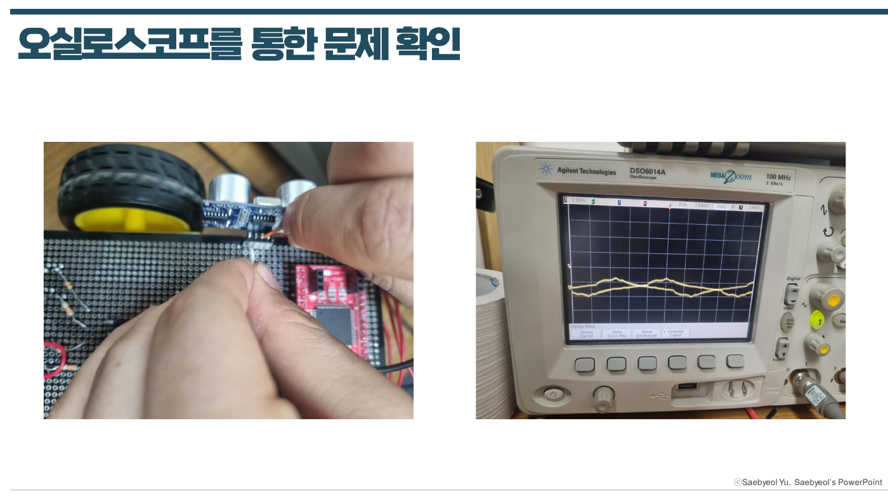
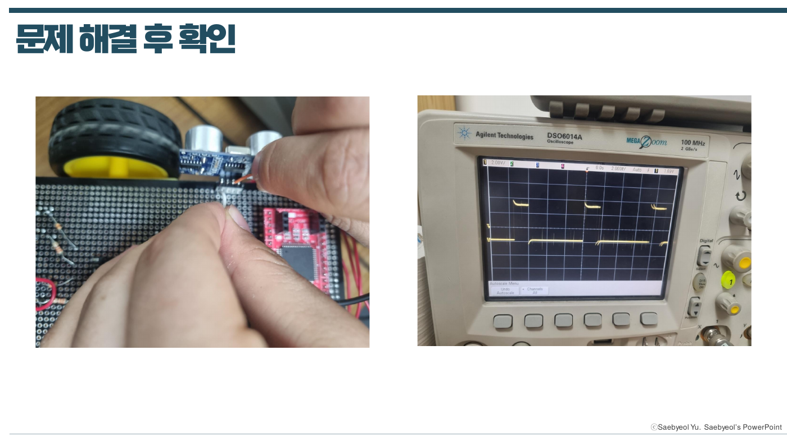
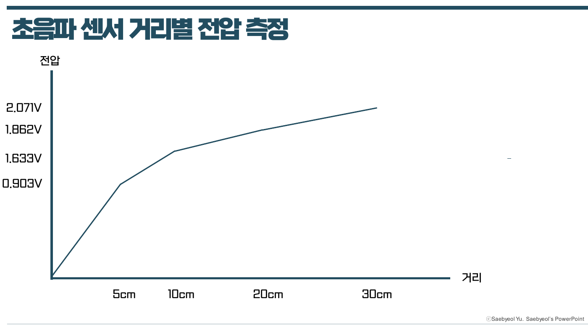
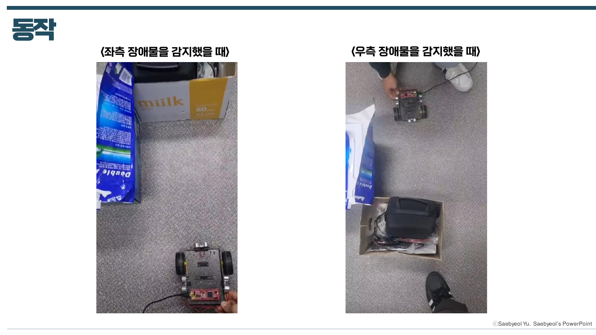
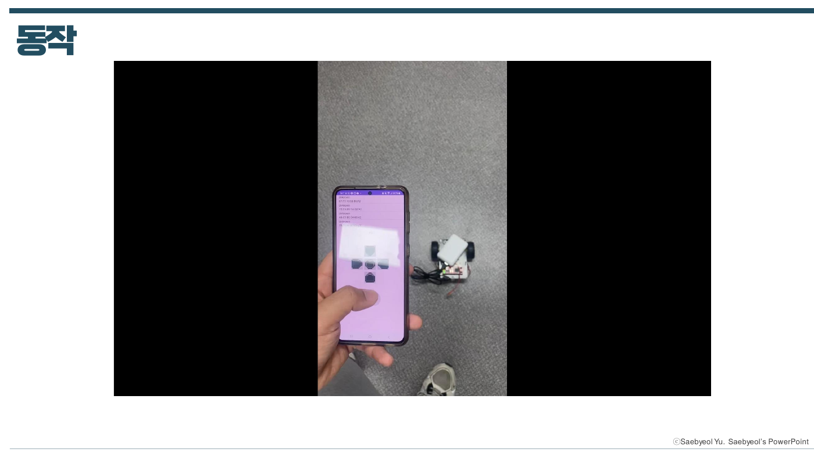

# 임베디드 로봇 프로젝트 (학부연구생)

[← 메인으로](../)

청주대학교 SNSLAB 학부연구생 활동으로, ATmega128 기반 이동 로봇을 단계적으로 확장하며 센서 · 통신 · 모터 제어를 직접 구현했습니다.

| 항목 | 내용 |
|---|---|
| 기간 | 2024.11 ~ |
| MCU | ATmega128 (Timer/Counter, External Interrupt, USART, ADC) |
| 센서 · 모듈 | 포토 센서, 초음파 센서(HC-SR04) × 3, 조도 센서, Bluetooth 모듈 |
| Tool | Atmel Studio (C), Android Studio, 오실로스코프, 멀티미터 |

 

## 진행 단계

| 단계 | 내용 | 자료 |
|---|---|---|
| 라인트레이서 | Timer/Counter PWM으로 DC 모터 제어, 포토 센서 라인 추종 | [08](docs/08_LineTracer.pdf) |
| 초음파 센서 | HC-SR04 거리 측정, 거리별 출력 전압 측정 | [09](docs/09_Ultrasonic_Sensor.pdf) · [10](docs/10_Ultrasonic_LineTracer.pdf) |
| 인터럽트 · UART | 외부 인터럽트와 초음파 센서 연동, USART 직렬 통신으로 거리값 출력 | [11](docs/11_UART_External_Interrupt.pdf) |
| 장애물 회피 | 초음파 센서 3개로 전방 · 좌 · 우 거리 비교 후 회피 방향 결정 | [12](docs/12_Three_Ultrasonic_Sensors.pdf) |
| 헤드라이트 | 조도 센서 + ADC로 밝기 측정, PWM으로 LED 밝기 제어 | [13-14](docs/13-14_Headlight_ADC_PWM.pdf) |
| 블루투스 | 스마트폰 원격 조종, 초음파 센서 미로 탈출 | [15](docs/15_Bluetooth.pdf) · [16](docs/16_Bluetooth_Remote_Control.pdf) |
| RC카 | Android 앱 직접 제작 (BLE GATT 서비스 · 특성) | [17](docs/17_RC_Car_Interim.pdf) · [18](docs/18_RC_Car.pdf) |

 

## 문제 해결 — 초음파 센서 3개 동시 사용 시 신호 이상

초음파 센서 3개를 연결한 뒤 동작이 이상해, 오실로스코프로 센서 신호를 직접 측정해 원인을 찾았습니다.

| 문제 확인 | 해결 후 |
|---|---|
|  |  |

- **현상**: 정상적인 펄스가 아닌 불규칙한 파형 관측 
- **원인**: 초음파 센서 접촉 불량 확인
- **해결**: 소켓 교체 후 초음파 센서 재결합 → 이후 정상 펄스 확인

 

## 결과

| 초음파 센서 거리별 전압 | 장애물 회피 동작 |
|---|---|
|  |  |

 직접 만든 Android 앱으로 RC카 조종

