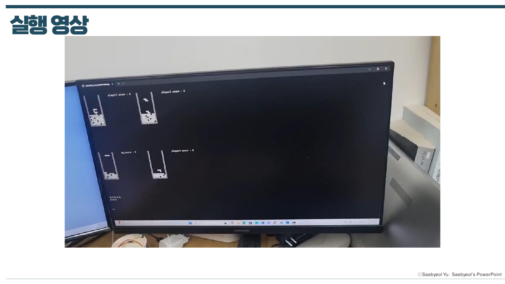
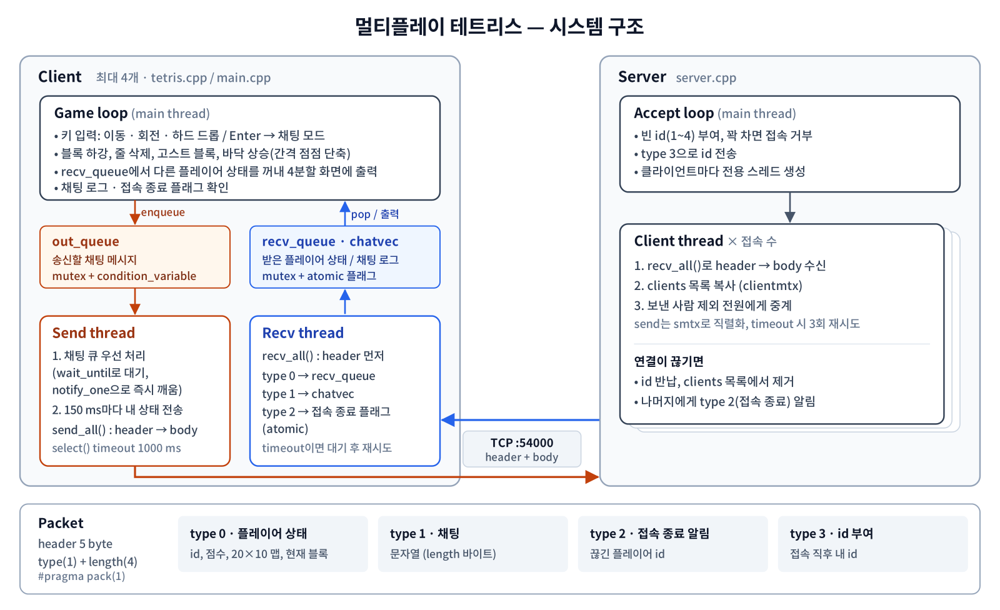

# 멀티플레이 테트리스

[← 메인으로](../)

C++ TCP 소켓으로 최대 4명이 동시에 접속해 서로의 게임 화면을 실시간으로 보고 채팅할 수 있는 콘솔 테트리스입니다.

| 항목 | 내용 |
|---|---|
| 기간 | 2025.08 ~ 2025.11 |
| 언어 | C++ (Visual Studio, Windows 콘솔, Winsock2) |
| 구성 | 서버 1 + 클라이언트 최대 4 |
| 핵심 기술 | TCP 소켓, 자체 패킷 프로토콜, 멀티스레드, `mutex` · `atomic` · `condition_variable` |
| 소스 코드 | [`src/client`](src/client/) (약 1,150줄) · [`src/server`](src/server/) (약 380줄) |
| 상세 자료 | [발표 자료 PDF](docs/Multiplayer_Tetris.pdf) (플로우차트 전체 포함) |



<br>

## 구조



```
src/
├── client/
│   ├── tetris.h      # 구조체(playerstate, header), 전역 변수, 함수 선언
│   ├── tetris.cpp    # 게임 로직, 화면 출력, 서버 연결, 송수신 스레드
│   └── main.cpp      # 전역 변수 정의, 블록 7종, 스레드 시작 / 종료
└── server/
    └── server.cpp    # 접속 관리, id 부여, 상태 · 채팅 중계
```

### 패킷 프로토콜
모든 데이터는 `header`(5 byte) 뒤에 본문을 붙여 보냅니다.

| type | 의미 | 본문 |
|---|---|---|
| 0 | 플레이어 상태 | `playerstate` (id, 점수, 20×10 맵, 현재 블록 좌표와 모양) |
| 1 | 채팅 | 문자열 |
| 2 | 다른 플레이어 접속 종료 | 플레이어 id |
| 3 | 접속 시 내 id 부여 | 플레이어 id |

<br>

## 구현 내용

**클라이언트**
- 서버 접속 후 id를 받고, 화면을 4분할해 내 위치에 맵 출력
- 송신 스레드: 채팅 큐를 우선 처리하고, 150 ms마다 내 `playerstate` 전송
- 수신 스레드: header type에 따라 채팅 로그 · 다른 플레이어 상태 큐 · 접속 종료 처리
- 게임: 고스트 블록(낙하 위치 미리보기), 하드 드롭, 바닥이 한 줄씩 올라오는 간격(10초 → 최소 1초)과 블록 낙하 속도가 점점 빨라지는 난이도

**서버**
- 접속할 때마다 빈 id(1~4)를 부여하고 클라이언트별 스레드 생성
- 받은 상태 · 채팅을 보낸 사람을 제외한 모든 클라이언트에게 중계, timeout 시 3회 재시도
- 연결이 끊기면 id를 반납하고 나머지 클라이언트에게 type 2로 통보

> 함수별 상세 플로우차트는 [발표 자료 PDF](docs/Multiplayer_Tetris.pdf)에 있습니다.

<br>

## 문제와 해결

| 문제 | 해결 | 코드 |
|---|---|---|
| `send()` / `recv()`가 요청한 크기만큼 한 번에 처리되지 않아 데이터가 잘림 | `select()`로 timeout을 두고, 원하는 바이트 수가 될 때까지 반복하는 `send_all()` / `recv_all()` 작성 | `tetris.cpp` |
| 구조체 padding 때문에 송수신 바이트가 어긋남 | `#pragma pack(push, 1)`로 1-byte 정렬, 서버와 클라이언트 구조체를 동일하게 유지 | `tetris.h` |
| blocking 함수 때문에 게임 루프가 멈춤 | 송신 / 수신 스레드를 분리하고 게임 루프는 큐만 확인 | `tetris.cpp` |
| 채팅을 보낼 때까지 송신 스레드가 계속 돌며 CPU 낭비 | `condition_variable::wait_until`로 대기하다가 채팅이 들어오면 `notify_one()`으로 즉시 깨움 | `enqueue_chat_send()` |
| 여러 스레드가 같은 데이터에 접근하는 race condition | 공유 데이터는 `mutex` + `lock_guard`, 플래그는 `atomic`으로 보호 | 전체 |

<br>

## 실행 방법 (Windows, Visual Studio)

1. `src/server/server.cpp`로 콘솔 프로젝트를 만들어 실행 (포트 54000)
2. `src/client/tetris.cpp`의 `sv_con()`에서 서버 IP를 서버 PC 주소로 변경 (같은 PC면 `127.0.0.1`)
3. `src/client`의 3개 파일로 콘솔 프로젝트를 만들어 실행 (최대 4개)

조작: ← → ↓ 이동 · `a` 좌회전 · `d` 우회전 · Space 하드 드롭 · Enter 채팅
